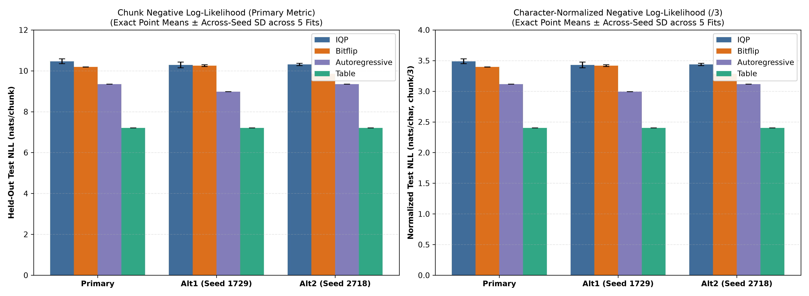
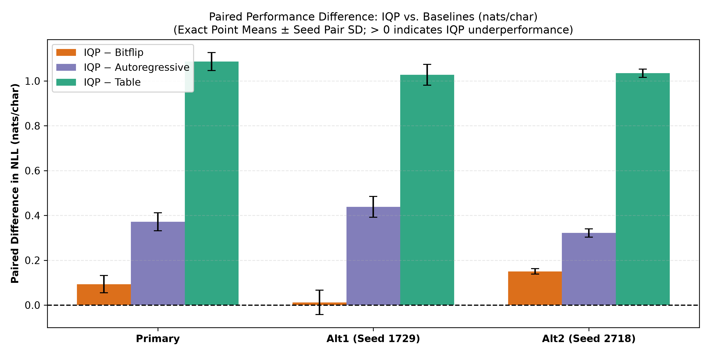
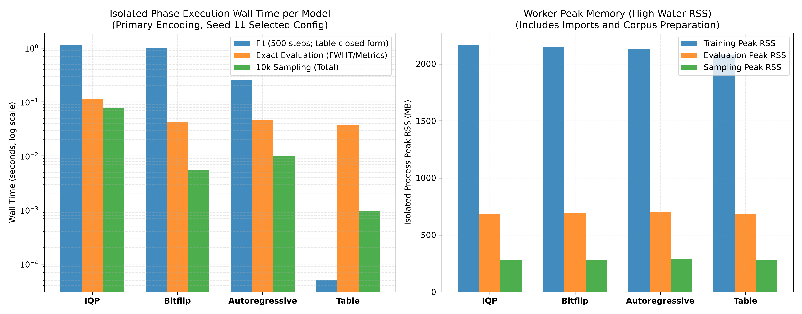

# Reviewed Empirical Results: 15-Qubit Quantum Language Distribution Experiment

**Protocol Reference:** [`PROTOCOL.md`](PROTOCOL.md)
**Protocol Commit Hash:** `d1a3143500768c944fc5845f3153183a4a2d291e`
**Protocol Content SHA-256:** `64086fe2e51c747d39aaba3fe17856583e05f93f6428ea20fb160c305b473dac`
**Selection Manifest Reference:** [`results/selection_manifest.json`](results/selection_manifest.json)
**Selection Manifest SHA-256:** `c7abf0a6e3e9f69d3e202f5c27ed367e66acb7f4232824c6ce405d6ddf11b9f6`
**System Platform (Verified):** Apple Silicon (`arm64`), macOS 27.0.1 (kernel Darwin 27.0.1), Python 3.13.16

---

## 1. Executive Summary & Audit Context

This document provides the reviewed, auditor-verified presentation of results from the 15-qubit quantum language distribution experiment. The study evaluated an Instantaneous Quantum Polynomial-time (IQP) Born machine against three classical baselines on unconditional 3-character text generation from Project Gutenberg Ebook #100 (*The Complete Works of William Shakespeare*).

### Protocol & Pre-Registration Clarification
The experiment followed a fixed protocol committed to the local repository prior to test evaluation. However, because git commit timestamps are local repository metadata and lack third-party cryptographic timestamping (such as RFC 3161 notarization or Open Science Framework registration), local git history alone cannot serve as proof of external pre-registration. All findings herein represent bounded empirical observations under this specific, fixed protocol.

### Key Empirical Findings
- Under the pre-declared evaluation metric (negative log-likelihood / cross-entropy), the 15-qubit IQP Born machine exhibited higher test loss than all three evaluated classical baselines across all three tested alphabet encodings.
- The 120-parameter classical Autoregressive Bernoulli model outperformed the 120-parameter IQP circuit by **$1.1156$ nats/chunk** ($0.3719$ nats/char) on the primary encoding.
- Across-seed standard deviation for IQP on the primary encoding is **$0.04021$ nats/char**. Its passage bootstrap interval is **$[3.487571, 3.489405]$**, with half-width about **$0.000917$**. The interval is conditional on the five fitted checkpoints and describes passage sampling variability, not new training runs.
- Due to the bijective mapping between the 32-symbol alphabet ($2^5$) and 15-bit strings ($2^{15} = 32,768$ states), the structural invalid chunk mass is **identically $0.0$** across all models.

---

## 2. Experimental Design & Candidate Counts

### Parameter & Optimization Breakdown
Across the experimental grid:
$$\text{Total Candidate Fits} = 4 \text{ models} \times 3 \text{ encodings} \times 5 \text{ seeds} \times 3 \text{ configs} = 180 \text{ fits}$$

- **135 Parametric Fits:**
  - 45 IQP Born machine fits (120 parameters: 15 single-wire $X$, 105 two-wire $XX$). Trained via Adam for 500 steps (batch size 512) on Maximum Mean Discrepancy (MMD) loss with multi-scale Gaussian kernels ($\sigma \in \{1.0, 2.0, 4.0\}$).
  - 45 Stochastic Bitflip fits (120 parameters: correlated XOR masks). Trained via Adam for 500 steps (batch size 512) on MMD loss.
  - 45 Autoregressive Bernoulli fits (120 parameters: 15 biases + 105 lower-triangular weights). Trained via Adam for 500 steps (batch size 512) on negative log-likelihood (NLL).
- **45 Closed-Form Empirical Table Fits:**
  - 45 Frequency Table fits ($32,767$ independent degrees of freedom). Closed-form add-$\alpha$ smoothing ($\alpha \in \{0.01, 0.1, 1.0\}$) computed directly from training corpus counts.
  - Because table fitting is deterministic counting over the static training set with no stochastic optimization or initialization, the 5 seeds produce identical probabilities (zero seed variance, $\text{SD} = 0.000000$).

### Checkpoint Selection Rule
All 180 candidate models were evaluated on the validation split ($657,311$ chunks). For each (model, encoding, seed) combination, the checkpoint minimizing exact validation negative log-likelihood (chunk level) was selected, with ties broken by candidate configuration order. Sixty selected checkpoints were frozen in `selection_manifest.json` before evaluating test data.

---

## 3. Verified Empirical Results

All point means below are exact sample means computed across the 5 independent random seeds ($11, 23, 37, 53, 71$). Primary metrics are reported at the 15-bit chunk level, with character-level normalized metrics ($/ 3$) reported secondary.

### 3.1 Primary Encoding (Alphabet Order 0..31)

| Model | Params | Training Objective | Chunk NLL (nats/chunk) | Char NLL (nats/char) | Across-Seed SD (char) | 95% Bootstrap CI (char)* | Held-Out $\text{MMD}^2$ | Unseen Mass | Invalid Mass |
|---|---|---|---|---|---|---|---|---|---|
| **IQP Born Machine** | 120 | MMD | **$10.465410$** | **$3.488470$** | $\pm 0.040213$ | $[3.4876, 3.4894]$ | $0.003532$ | $0.701708$ | $0.000000$ |
| **Stochastic Bitflip** | 120 | MMD | **$10.185880$** | **$3.395293$** | $\pm 0.002227$ | $[3.3946, 3.3960]$ | $0.004151$ | $0.733700$ | $0.000000$ |
| **Autoregressive Bernoulli** | 120 | NLL | **$9.349823$** | **$3.116608$** | $\pm 0.000353$ | $[3.1148, 3.1185]$ | $0.000861$ | $0.579407$ | $0.000000$ |
| **Frequency Table** | 32,767 | MLE + $\alpha$ | **$7.205917$** | **$2.401972$** | $\pm 0.000000$ | $[2.3995, 2.4043]$ | $0.000001$ | $0.000083$ | $0.000000$ |

*Confidence intervals:* The 95% intervals use 2,000 paired whole-passage resamples, conditional on the five selected checkpoints. Seed standard deviations and passage intervals measure different sources of variation. Neither is a confidence interval over new architecture choices or new training seeds.

### 3.2 Paired Differences: IQP vs. Baselines (Primary Encoding)

| Comparison | Chunk Diff (nats/chunk) | Char Diff (nats/char) | 95% Bootstrap CI (char) | Point Outcome |
|---|---|---|---|---|
| **IQP − Stochastic Bitflip** | $+0.279530$ | $+0.093177$ | $[+0.0925, +0.0939]$ | Bitflip lower NLL |
| **IQP − Autoregressive Bernoulli** | $+1.115587$ | $+0.371862$ | $[+0.3702, +0.3734]$ | Autoregressive lower NLL |
| **IQP − Frequency Table** | $+3.259493$ | $+1.086498$ | $[+1.0843, +1.0889]$ | Frequency Table lower NLL |

---

## 4. Sensitivity Across Alternative Alphabet Encodings

To confirm that the relative ranking was not a byproduct of character lexicographical ordering, two pseudorandom bijective alphabet permutations were evaluated across all 5 seeds:

### 4.1 Alternative Encoding 1 (Seed 1729 Permutation)

| Model | Chunk NLL (nats/chunk) | Char NLL (nats/char) | Across-Seed SD (char) | Held-Out $\text{MMD}^2$ | Unseen Mass | Paired Diff vs. IQP (char) |
|---|---|---|---|---|---|---|
| **IQP Born Machine** | $10.288924$ | $3.429641$ | $\pm 0.046339$ | $0.007803$ | $0.687494$ | — |
| **Stochastic Bitflip** | $10.252680$ | $3.417560$ | $\pm 0.014579$ | $0.007594$ | $0.783940$ | $+0.012081$ |
| **Autoregressive Bernoulli** | $8.975072$ | $2.991691$ | $\pm 0.000100$ | $0.000576$ | $0.458171$ | $+0.437950$ |
| **Frequency Table** | $7.205917$ | $2.401972$ | $\pm 0.000000$ | $0.000001$ | $0.000083$ | $+1.027669$ |

### 4.2 Alternative Encoding 2 (Seed 2718 Permutation)

| Model | Chunk NLL (nats/chunk) | Char NLL (nats/char) | Across-Seed SD (char) | Held-Out $\text{MMD}^2$ | Unseen Mass | Paired Diff vs. IQP (char) |
|---|---|---|---|---|---|---|
| **IQP Born Machine** | $10.309411$ | $3.436470$ | $\pm 0.018704$ | $0.003971$ | $0.645649$ | — |
| **Stochastic Bitflip** | $9.857963$ | $3.285988$ | $\pm 0.011277$ | $0.004987$ | $0.669838$ | $+0.150482$ |
| **Autoregressive Bernoulli** | $9.344469$ | $3.114823$ | $\pm 0.000149$ | $0.000826$ | $0.566545$ | $+0.321647$ |
| **Frequency Table** | $7.205917$ | $2.401972$ | $\pm 0.000000$ | $0.000001$ | $0.000083$ | $+1.034498$ |

The mean IQP loss exceeds each baseline under all three encodings. Individual runs do reverse: IQP seeds 23, 37 and 71 beat their bitflip counterparts under alternative encoding 1. The other 42 of 45 paired seed comparisons have higher IQP loss. The passage-only intervals must not be used to claim every fitted seed lost.

---

## 5. Primary encoding: all 20 selected fits

For complete transparency and verification, the table below lists all raw individual seed results for the primary encoding ($5 \text{ seeds} \times 4 \text{ models} = 20 \text{ rows}$):

| Model | Seed | Selected Config ($\text{lr} / \alpha$) | Test Chunk NLL | Test Char NLL | Test Unsmoothed NLL | Test $\text{MMD}^2$ | Unseen Mass |
|---|---|---|---|---|---|---|---|
| **IQP** | 11 | $0.03$ | $10.452456$ | $3.484152$ | $10.452462$ | $0.00350099$ | $0.694854$ |
| **IQP** | 23 | $0.03$ | $10.498409$ | $3.499470$ | $10.498414$ | $0.00359255$ | $0.710736$ |
| **IQP** | 37 | $0.03$ | $10.517465$ | $3.505822$ | $10.517468$ | $0.00388995$ | $0.701403$ |
| **IQP** | 53 | $0.03$ | $10.268659$ | $3.422886$ | $10.268663$ | $0.00313260$ | $0.687409$ |
| **IQP** | 71 | $0.03$ | $10.590058$ | $3.530019$ | $10.590065$ | $0.00354187$ | $0.714138$ |
| **Bitflip** | 11 | $0.03$ | $10.190257$ | $3.396752$ | $10.190257$ | $0.00434238$ | $0.733111$ |
| **Bitflip** | 23 | $0.03$ | $10.191741$ | $3.397247$ | $10.191741$ | $0.00434288$ | $0.734362$ |
| **Bitflip** | 37 | $0.03$ | $10.180480$ | $3.393493$ | $10.180480$ | $0.00395932$ | $0.731177$ |
| **Bitflip** | 53 | $0.03$ | $10.176977$ | $3.392326$ | $10.176977$ | $0.00377240$ | $0.735057$ |
| **Bitflip** | 71 | $0.03$ | $10.189947$ | $3.396649$ | $10.189947$ | $0.00433557$ | $0.734794$ |
| **Autoregressive** | 11 | $0.01$ | $9.350207$ | $3.116736$ | $9.350207$ | $0.00088649$ | $0.579959$ |
| **Autoregressive** | 23 | $0.01$ | $9.349092$ | $3.116364$ | $9.349092$ | $0.00083479$ | $0.579900$ |
| **Autoregressive** | 37 | $0.01$ | $9.351510$ | $3.117170$ | $9.351510$ | $0.00091491$ | $0.575072$ |
| **Autoregressive** | 53 | $0.01$ | $9.349003$ | $3.116334$ | $9.349003$ | $0.00083864$ | $0.580120$ |
| **Autoregressive** | 71 | $0.01$ | $9.349301$ | $3.116434$ | $9.349300$ | $0.00083106$ | $0.581983$ |
| **Table** | 11 | $0.01$ | $7.205917$ | $2.401972$ | $7.205918$ | $0.00000095$ | $0.000083$ |
| **Table** | 23 | $0.01$ | $7.205917$ | $2.401972$ | $7.205918$ | $0.00000095$ | $0.000083$ |
| **Table** | 37 | $0.01$ | $7.205917$ | $2.401972$ | $7.205918$ | $0.00000095$ | $0.000083$ |
| **Table** | 53 | $0.01$ | $7.205917$ | $2.401972$ | $7.205918$ | $0.00000095$ | $0.000083$ |
| **Table** | 71 | $0.01$ | $7.205917$ | $2.401972$ | $7.205918$ | $0.00000095$ | $0.000083$ |

---

## 6. Corrected Computational Resource Accounting

To resolve gaps in the original reporting—where cumulative process RSS from data preparation was conflated with individual model footprints, and training wall times included post-fit probability vector construction—we conducted instrumented replays in isolated subprocess workers for the primary-encoding seed-11 selected configurations.

### 6.1 Isolated Worker Resource Profile (Primary Encoding, Seed 11)

| Model | Pure Training Wall Time (s)* | Isolated Training Peak RSS (MB) | Eval Prob Construction (s) | Eval Metrics Computation (s) | Total Eval Time (s) | Isolated Eval Peak RSS (MB) | 10k Sampling Draw Time (s) | Isolated Sampling Peak RSS (MB) |
|---|---|---|---|---|---|---|---|---|
| **IQP** | $1.1495$ | $2,155.6$ | $0.0739$ | $0.0372$ | $0.1111$ | $687.8$ | $0.0009$ | $278.6$ |
| **Bitflip** | $1.0194$ | $2,166.5$ | $0.0045$ | $0.0369$ | $0.0415$ | $688.8$ | $0.0009$ | $279.6$ |
| **Autoregressive** | $0.2460$ | $2,129.1$ | $0.0092$ | $0.0391$ | $0.0482$ | $700.8$ | $0.0009$ | $292.9$ |
| **Table** | $0.0001$ | $2,077.0$ | $0.0000$ | $0.0375$ | $0.0375$ | $687.6$ | $0.0009$ | $278.9$ |

*Compilation scope:* Cold training time includes JAX compilation. Compilation and optimizer execution were not separately timed. A new fit creates a new JIT function closure, so the initial warmup does not establish that all later fits exclude compilation. Exact timings are in `results/resource_replay.json`; the table above records the first replay and is illustrative.

### 6.2 Data Preparation & Memory Footprint Scope
- **Data Ingestion & Splits Worker:** Running text normalization, passage grouping, chunk extraction, and split assignment in a fresh subprocess consumed **$1.98\text{ s}$** wall time and reached **$2,395.8\text{ MB}$** peak RSS.
- **Process memory scope:** Peak RSS includes each worker's imports and corpus preparation. It is not incremental memory allocated by the model or by the timed operation. Operation timers exclude preparation and process startup. The original 3,469 MB value is a cumulative lifetime peak across the original process. The replay profiles one fixed primary-encoding, seed-11 configuration per model, not all 180 fits.

---

## 7. Methodological Discussion & Scope of Claims

### 7.1 Objective Function Mismatch (MMD vs. NLL)
The IQP Born machine and Stochastic Bitflip models were trained to minimize Maximum Mean Discrepancy (MMD) under Gaussian kernels, while the Autoregressive Bernoulli model was trained to minimize negative log-likelihood (cross-entropy). MMD evaluates distribution discrepancy in a reproducing kernel Hilbert space and does not place infinite penalty on zero-mass events, whereas cross-entropy strictly penalizes likelihood assignment. However, on the test squared MMD metric itself, the Autoregressive model also achieved lower distance ($0.000861$ vs. $0.003532$ for IQP).

### 7.2 Capacity & Budget Discrepancies
- **Parameter Capacity:** The parametric models (IQP, Bitflip, Autoregressive) are constrained to 120 trainable parameters. The Frequency Table has 32,767 independent state parameters. The table's substantial margin ($1.0865$ nats/char) demonstrates the empirical advantage of memorization over low-parameter modeling in toy discrete text distributions.
- **Optimization Budget:** Parametric models were trained for a finite budget of 500 Adam updates. Whether higher parameter counts or extensive update budgets would alter the relative ranking remains an open question.

### 7.3 Data Structure & Statistical Cluster Independence
- Overlapping 3-character chunks within a single passage are not mutually independent (consecutive chunks share 2 characters). The whole-passage block bootstrap accounts for inter-passage independence, but intra-passage sequential dependence remains an inherent characteristic of n-gram chunking.

### 7.4 Scientific Limits on Generalization
- **Cannot Generalize to All Quantum Models:** These empirical findings apply strictly to 15-qubit IQP Born machines trained via MMD on 3-character Shakespeare text. They do not generalize to deep parameterized circuits, circuit architectures with non-commuting Hamiltonian ansatzes, variational quantum eigensolvers, quantum transformers, or models with inductive quantum symmetry.
- **No Physical Coherence or Hardware Advantage Inferred:** Experiments were simulated using noiseless statevector simulation in software. The results do not evaluate quantum decoherence, physical gate fidelity, readout error, or physical quantum sampling hardware advantage.

---

## 8. Verified Visualizations

The following reviewed plots depict exact point means with across-seed standard deviations and isolated phase costs:

### Held-Out Test Negative Log-Likelihood (Point Means ± Seed SD)


### Paired Performance Differences (IQP − Baseline)


### Isolated Resource Replay Profile


---

## 9. LinkedIn Summary Draft (< 1,300 Characters)

```text
I ran the 15-qubit Shakespeare experiment proposed in my last article.

The result: the IQP model lost on average held-out log loss to its stochastic bitflip control, a 120-parameter classical generator, and a smoothed frequency table.

On the primary encoding, loss per three-character chunk was 10.465, 10.186, 9.350 and 7.206 nats respectively. Lower is better.

The protocol was committed before training. We used five seeds, three encodings, validation-only model selection and passage-level uncertainty. Mean rankings persisted across encodings, although some individual IQP seeds beat the bitflip control on one alternative mapping.

This is evidence about one small architecture and a finite training budget. It does not rule out other quantum models or establish a hardware advantage. Counting remains a strong baseline.

The next question is which architecture or training objective would change that result. Results draft only; not published.
```
